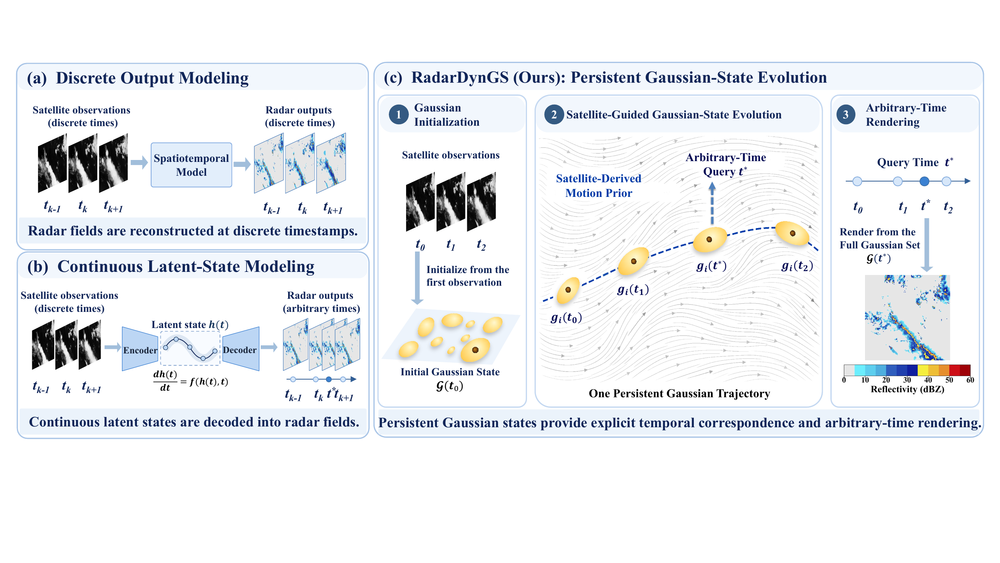

# RadarDynGS

**RadarDynGS: Satellite-Guided Persistent Gaussian-State Evolution for Radar Sequence Reconstruction**

Official repository for RadarDynGS, a satellite-guided framework for radar sequence reconstruction through persistent Gaussian-state evolution.

## Overview

RadarDynGS models radar reflectivity sequences using persistent 2D Gaussian primitives whose positions, shapes, and effective intensities evolve continuously under satellite guidance.

The framework enables radar reflectivity reconstruction at observation times and intermediate timestamps.

[View the overview figure as PDF](assets/intro_tgrs_261112v1.pdf).

## Code Release

The source code, pretrained models, and implementation instructions are planned to be released upon paper acceptance.

## Paper

The manuscript is currently under preparation for submission to IEEE Transactions on Geoscience and Remote Sensing (TGRS).

## Contact

For questions regarding this work, please contact the authors through the repository.
