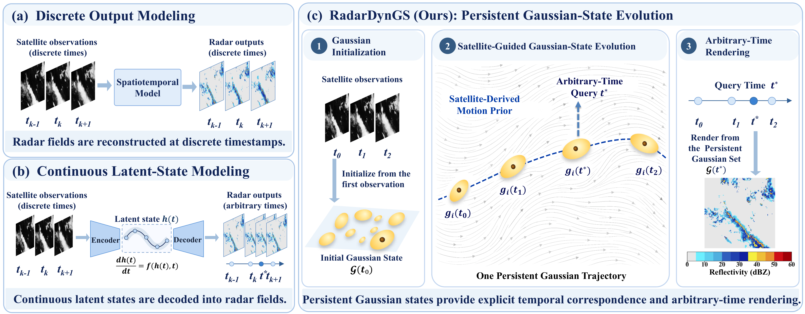

# RadarDynGS

**RadarDynGS: Satellite-Guided Persistent Gaussian-State Evolution for Radar Sequence Reconstruction**

Official repository for **RadarDynGS**, a satellite-to-radar reconstruction framework that models radar sequences through the continuous evolution of persistent Gaussian states.

**Paper status:** Under submission. Code, pretrained models, and data preparation instructions will be released upon acceptance.

